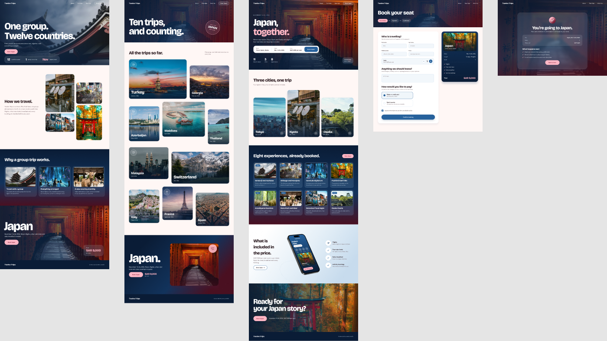
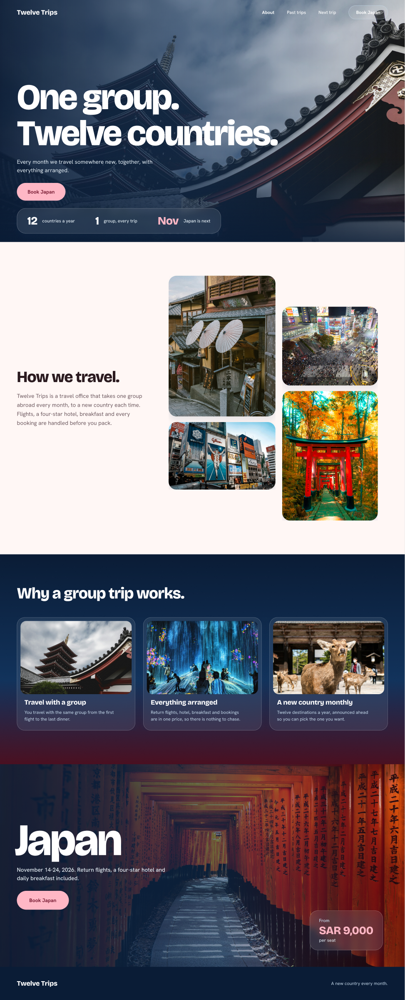
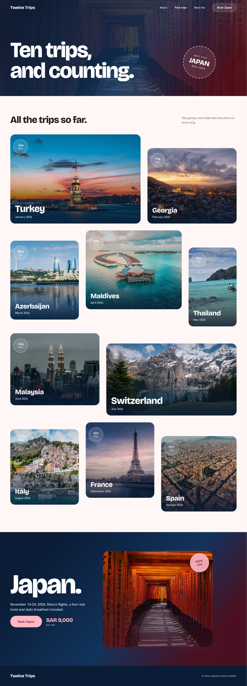
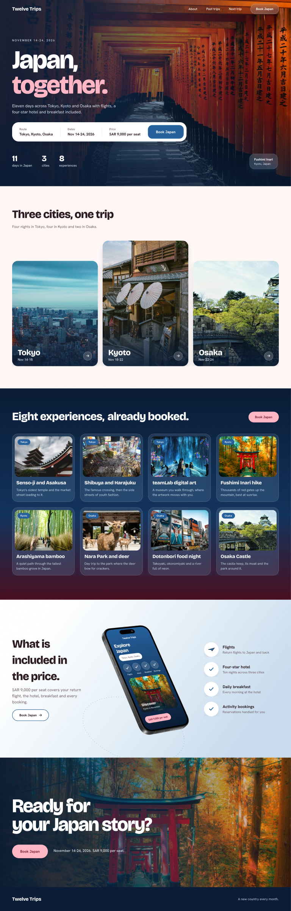
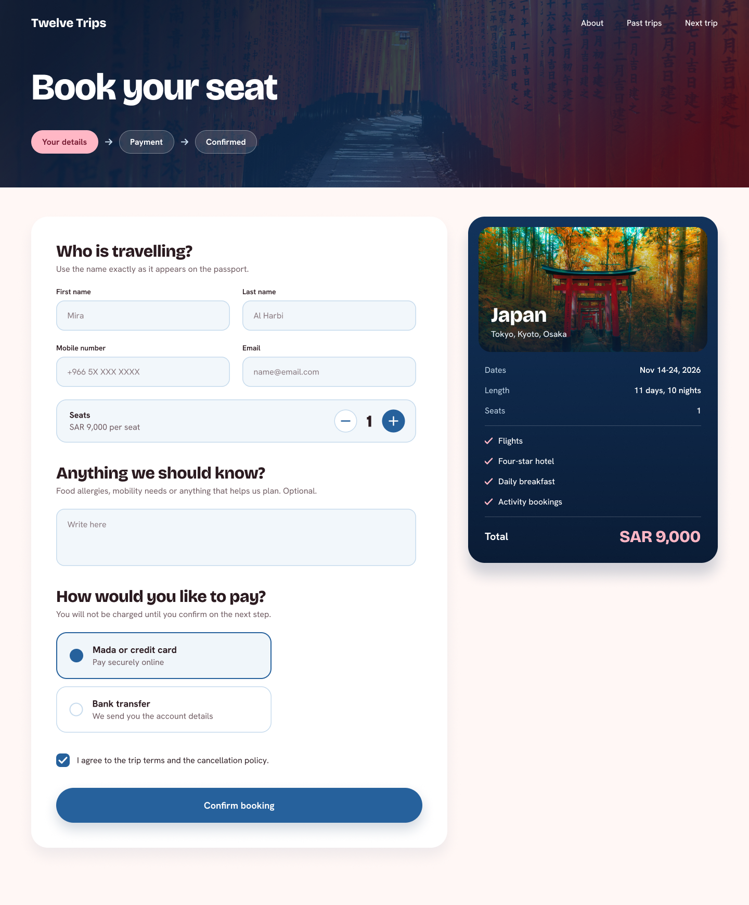
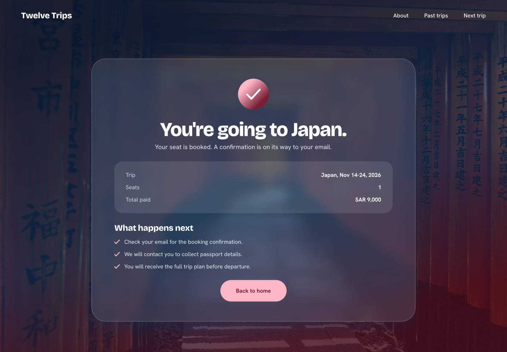

# Twelve Trips: Group Travel Website (UI/UX Design)

**Twelve Trips** is a concept website for a travel office that takes **one group to a new country every month**. I designed the full booking journey in Figma: discovering the brand, browsing past trips, exploring the next destination, and booking a seat.

🔗 **[Open the Figma file](https://www.figma.com/design/6SG0s6eya6TDiHZA4aJouk/Twelve-Trips)**

---

## 🎯 Design Goals

- **Make the next trip clear.** Every page leads to one action: *Book Japan*.
- **Show the full price upfront.** Flights, hotel, breakfast and activities are listed next to one fixed price.
- **Keep booking short.** Three steps (Your details → Payment → Confirmed), with a summary card that stays visible.

## 🖥️ Screens

| # | Screen | What it does |
|---|---|---|
| 1 | **Home / About** | Brand story, stats (12 countries a year, 1 group), why a group trip works, next-trip teaser |
| 2 | **Past Trips** | Editorial gallery of 10 past destinations with month badges |
| 3 | **Japan Trip** | Hero with a booking bar, 3 cities, 8 pre-booked experiences, what's included (with phone mockup) |
| 4 | **Booking** | Traveller details, seat counter, notes, payment method (Mada/card or bank transfer), sticky order summary |
| 5 | **Booking Confirmed** | Success state with a trip summary and "what happens next" |

<table>
<tr>
<td width="33%"></td>
<td width="33%"></td>
<td width="33%"></td>
</tr>
</table>

<table>
<tr>
<td width="55%"></td>
<td width="45%"></td>
</tr>
</table>

## 🎨 Visual Language

- **Palette:** deep navy, Fushimi Inari vermilion, and a soft pink accent for primary actions.
- **Typography:** large condensed display headlines with a clean sans-serif for body text.
- **Components:** glass-style cards, pill buttons, date badges and a three-step progress indicator.

## 🛠️ Tools

Figma (auto layout, components, prototyping)

## 👩‍🎨 Designer

**Mira Alharbi**

> Concept project for my portfolio. Photos are used as placeholders.
